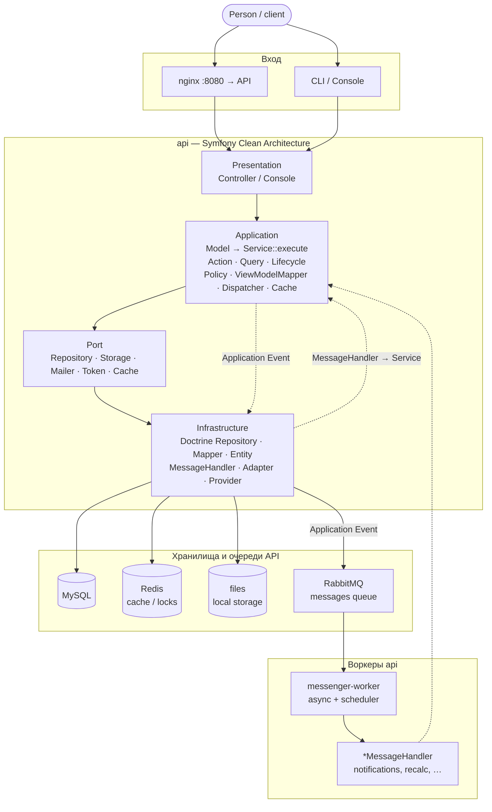

# cln-arch-sym-simple

Локальный монорепозиторий. В корне три каталога:

| Каталог | Назначение |
|---------|-----------|
| [`api/`](api/README.md) | Основной Symfony API (MySQL, JWT, бизнес-логика) |
| [`docker/`](docker/README.md) | Docker Compose для локальной разработки (nginx, PHP, база, воркеры) |
| [`openspec/`](openspec/specs/overview/spec.md) | Спеки, changes и процесс Spec-Driven Development |

## Разработка по SDD (OpenSpec)

Проект использует [OpenSpec](https://openspec.dev) — Spec-Driven Development:
сначала согласуем план (proposal → specs `deltas` → design → tasks), затем
пишем код, после — архивируем change с обновлением main-спек.

```
openspec/changes/<change-id>/proposal.md + specs/ + design.md + tasks.md → код → archive
```

Итоговое поведение системы — в `openspec/specs/` (источник истины).

Спеки пишутся на русском; структурные заголовки (`## Purpose`,
`### Requirement:`, `#### Scenario:`, GIVEN/WHEN/THEN) и ключевые слова
SHALL/MUST — на английском.

Архитектурные правила (конституция) — в [`api/CLAUDE.md`](api/CLAUDE.md) и
вложенных файлах (`api/src/Application/CLAUDE.md`,
`api/src/Infrastructure/CLAUDE.md`, `api/tests/CLAUDE.md`). Спеки не
дублируют правила, а ссылаются на разделы. Расхождения фактического
поведения с задокументированным контрактом фиксируются в `## Notes` спек.

### Структура

```
openspec/
├── config.yaml      # контекст проекта и правила для артефактов
├── specs/           # источник истины: как система работает СЕЙЧАС
│   ├── auth/ users/ tasks/ task-groups/ assets/ files/
│   ├── notifications/ platform/ overview/   (spec.md в каждой)
└── changes/         # изменения в работе + archive/ (история)
```

### Когда нужен change

Change (папка в `openspec/changes/`) обязателен для:

- новой фичи или use case;
- изменения публичного контракта (HTTP/CLI, wire-Model);
- миграции БД или изменения схемы;
- async / очередей / scheduler / кэша;
- изменений в безопасности и доступах.

Для мелких правок (опечатка, локальный рефакторинг без изменения поведения)
change не нужен.

### Поток

```
explore → propose (proposal + specs deltas + design + tasks) → review
        → apply (задачи из tasks.md) → archive (deltas → specs/, история в archive/)
```

1. **explore** — обдумать идею без кода (опционально).
2. **propose** — агент создаёт change: `proposal.md` (зачем, scope),
   `specs/` (дельты требований ADDED/MODIFIED/REMOVED), `design.md`
   (технический подход, когда нужен), `tasks.md` (чеклист).
3. **review** — правим артефакты до кода.
4. **apply** — реализация по tasks.md, отмечаем галочки по ходу.
5. **archive** — дельты вливаются в `openspec/specs/`, change уезжает в
   `changes/archive/YYYY-MM-DD-<id>/`.

Артефакты правятся в любой момент — фазовых ворот нет.

### Установка и обновление OpenSpec

Файлы скиллов opencode (`.opencode/skills/`) генерируются OpenSpec и **не
хранятся в git** — каждый разработчик создаёт их у себя.

Шаг 1 — установить CLI (standalone, Node не нужен):

```powershell
irm https://openspec.dev/cli/install.ps1 | iex
```

CLI кладётся в `%LOCALAPPDATA%\Programs\openspec` и добавляется в PATH;
проверка — `openspec --version`.

Шаг 2 — сгенерировать файлы скиллов в проекте:

```bash
openspec update
```

После этого в opencode появляются скиллы `openspec-*` — модель видит их
нативно и подхватывает сама. Вызвать конкретный можно явно: `@openspec-propose`
в промпте или фразой «используй openspec-propose».
Версию файлов держим одну на всю команду: обновляем через
`openspec update` и фиксируем версию CLI в обсуждении PR.

Альтернатива без standalone-бинаря: `npm install -g @fission-ai/openspec`
(нужен Node.js ≥ 22.12).

### Скиллы opencode

| Скилл | Что делает |
|-------|-----------|
| `openspec-explore` | обдумать идею с чтением кода |
| `openspec-propose` | создать change (артефакты планирования) |
| `openspec-apply-change` | реализовать задачи из `tasks.md` |
| `openspec-update-change` | скорректировать артефакты плана |
| `openspec-sync-specs` | влить дельты в main-спеки (без архива) |
| `openspec-archive-change` | завершить и заархивировать change |

Расширенный профиль (`openspec-new-change`, `openspec-continue-change`,
`openspec-ff-change`, `openspec-verify-change`,
`openspec-bulk-archive-change`, `openspec-onboard`) включается через
`openspec config profile` + `openspec update`.

### Definition of Done

Change считается сделанным, когда:

- [ ] все пункты `tasks.md` отмечены;
- [ ] `composer cs-check` проходит;
- [ ] `composer phpstan` проходит;
- [ ] добавлены/обновлены тесты и `php bin/phpunit` проходит;
- [ ] дельты спек отражают итоговое поведение (и влиты в `specs/` при archive);
- [ ] при изменении поведения обновлён `README.md` / `CLAUDE.md`.

Команды выполняются из `api/` (в Docker — через
`docker compose -f ../docker/docker-compose.yml exec php ...`, см.
[`api/README.md`](api/README.md)).

---

## Как устроен проект (от пользователя к данным)



### Коротко

1. **Человек** обращается к `nginx` (`:8080` — API) или запускает Console.
2. **Presentation** собирает запрос `*Model` (`fromArray`) и вызывает `*Service::execute`. Console разбирает CLI и вызывает Lifecycle-`*Service`.
3. **Application**: Policy → persistence `*Model` → Port. Action / Query возвращают только ответ `*ViewModel` | список | страницу | void. После записи Lifecycle обновляет кэш и публикует Application Event (`*Dispatcher`).
4. **Infrastructure** реализует Port: MySQL (Doctrine), Redis, файлы. Application Event уходит в очередь RabbitMQ `messages`.
5. **messenger-worker** читает очередь: `*MessageHandler` вызывает Application-`*Service` (notifications, recalc). Тот же воркер исполняет scheduler.

Соглашения по слоям: [`api/src/Application/CLAUDE.md`](api/src/Application/CLAUDE.md), [`api/src/Infrastructure/CLAUDE.md`](api/src/Infrastructure/CLAUDE.md).
