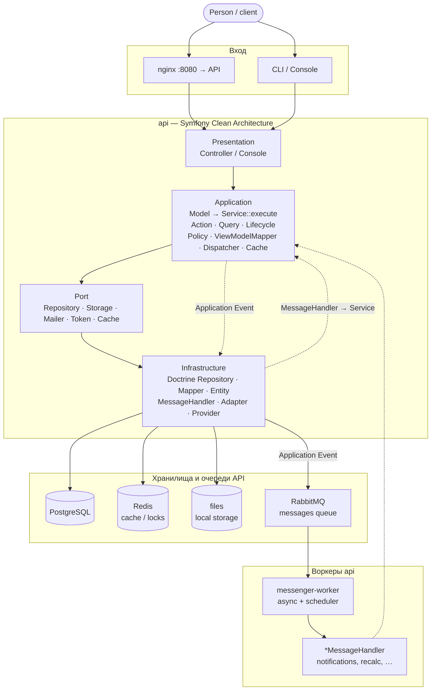

# cln-arch-sym-simple

Локальный монорепозиторий. В корне три каталога:

| Каталог | Назначение |
|---------|-----------|
| [`api/`](api/README.md) | Основной Symfony API (PostgreSQL, JWT, бизнес-логика) |
| [`docker/`](docker/README.md) | Docker Compose для локальной разработки (nginx, PHP, база, воркеры) |
| [`openspec/`](openspec/README.md) | Спеки, changes и процесс Spec-Driven Development |

## Быстрый старт

С нуля, одной командой (Windows, PowerShell 5.1+):

```powershell
.\build.ps1
# или двойным кликом по build.cmd
```

Скрипт проверяет git и Docker, включает git-хуки, ставит PHP-зависимости на
хосте (если есть `php` + `composer`) и поднимает стек:
`docker compose up -d --wait`. Образ php собирается автоматически, если его
нет, а entrypoint контейнера сам выполняет `composer install` и миграции.

Флаги: `-WithWorkers` (поднять messenger-worker), `-Build` (пересобрать
образы), `-SkipComposer` (не ставить зависимости на хосте),
`-TimeoutSeconds <сек>` (ожидание готовности, по умолчанию 600).

После запуска API — <http://localhost:8080> (проверка: `GET /api/assets`
отвечает 401 без токена), RabbitMQ UI — <http://localhost:15673>.

## Разработка по SDD (OpenSpec)

Проект использует [OpenSpec](https://openspec.dev) — Spec-Driven Development:
сначала согласуем план (proposal → specs `deltas` → design → tasks), затем
пишем код, после — архивируем change с обновлением main-спек.

```
openspec/changes/<change-id>/proposal.md + specs/ + design.md + tasks.md → код → archive
```

Итоговое поведение системы — в `openspec/specs/` (источник истины).
Карта доменов, связи схемы данных и глоссарий — в
[`openspec/README.md`](openspec/README.md).

Спеки пишутся на русском; структурные заголовки (`## Purpose`,
`### Requirement:`, `#### Scenario:`, GIVEN/WHEN/THEN) и ключевые слова
SHALL/MUST — на английском.

Архитектурные правила (конституция) — в [`api/AGENTS.md`](api/AGENTS.md) и
вложенных файлах (`api/src/Application/AGENTS.md`,
`api/src/Infrastructure/AGENTS.md`, `api/tests/AGENTS.md`). Спеки не
дублируют правила, а ссылаются на разделы. Расхождения фактического
поведения с задокументированным контрактом фиксируются в `## Notes` спек.

### Структура

```
openspec/
├── config.yaml      # контекст проекта и правила для артефактов
├── README.md        # индекс: карта доменов, схема данных, глоссарий
├── schemas/         # workflow-схема проекта (fork`spec-driven` → cln-flow)
│   └── cln-flow/    #   schema.yaml + templates/*.md — правим здесь
├── specs/           # источник истины: как система работает СЕЙЧАС
│   ├── auth/ users/ tasks/ task-groups/ assets/ files/
│   ├── notifications/ wire/ errors/ query/ async/   (spec.md в каждой)
└── changes/         # изменения в работе + archive/ (история)
```

Change называется `<ticket>-<slug>`, где `<ticket>` — номер задачи трекера в
нижнем регистре (`ecom-1234-avatar-replace`); CLI заглавные в имени отвергает.
Оригинальный номер и ссылка на work package — первой строкой `proposal.md`
под заголовком (`**Задача**: ECOM-1234 — <ссылка>`): workflow берёт его оттуда.

### Когда нужен change

Change (папка в `openspec/changes/`) обязателен для:

- новой фичи или use case;
- изменения публичного контракта (HTTP/CLI, wire-Model);
- миграции БД или изменения схемы;
- async / очередей / scheduler / кэша;
- изменений в безопасности и доступах.

Для мелких правок (опечатка, локальный рефакторинг без изменения поведения)
change не нужен.

**До выхода в продакшен** допускается вносить изменения в код и сразу
обновлять `openspec/specs/` без change — внешних потребителей контракта
нет, риск несовместимости отсутствует. С появлением продакшена это правило
перестаёт действовать: изменения публичного контракта снова идут через
propose → apply → archive.

### Поток

```
propose (proposal + specs deltas + design + tasks) → анализ и утверждение
        → apply (задачи из tasks.md) → review + тесты → critic
        → verification.md → archive (deltas → specs/, история в archive/)
```

1. **propose** — человек запускает `@openspec-propose <ticket> <текст>`; агент
   создаёт change: `proposal.md` (зачем, scope, строка `**Задача**`), `specs/`
   (дельты ADDED/MODIFIED/REMOVED), `design.md` (когда нужен), `tasks.md`.
2. **анализ** — субагент `analyst` читает work package и сверяет артефакты с
   задачей, main-спеками и `AGENTS.md`; расхождения правятся через
   `@openspec-update-change`. Дальше — только после утверждения.
3. **apply** — `@openspec-apply-change`: реализация по `tasks.md`, галочки по
   ходу, проверки (`cs-check`, `phpstan`, `phpunit`) на каждой группе задач.
4. **review + тесты** — параллельно субагенты `reviewer` (конвенции `AGENTS.md`)
   и `test-runner` (итоги прогонов без логов).
5. **critic** — независимая проверка по `BASE` (без рассуждений исполнителя),
   не больше двух раундов; затем заполняется `verification.md`.
6. **archive** — дельты вливаются в `openspec/specs/`, change уезжает в
   `changes/archive/YYYY-MM-DD-<id>/`; статус задачи в трекере обновляется
   только по явному согласию.

Шаги 2–6 ведает workflow **`task-flow`** (см. ниже): он вызывает openspec-скиллы
и добавляет гейты, которых в OpenSpec нет. Планирование остаётся ручным —
propose запускает человек.

Артефакты правятся в любой момент — фазовых ворот нет, кроме двух явных:
утверждение плана перед реализацией и `verification.md` перед архивацией.

### Установка и обновление OpenSpec

Файлы скиллов opencode (`.opencode/skills/`) и файлы workflow (`.opencode/agents/`,
`.opencode/skills/task-flow/`) **версионируются в git** — разработчик получает их
сразу после клона. Не отслеживаются только служебные `.opencode/node_modules/`,
`package.json` и lock-файлы (см. `.gitignore`).

Шаг 1 — установить CLI (standalone, Node не нужен):

```powershell
irm https://openspec.dev/cli/install.ps1 | iex
```

CLI кладётся в `%LOCALAPPDATA%\Programs\openspec` и добавляется в PATH;
проверка — `openspec --version`.

Шаг 2 — сгенерировать файлы скиллов в проекте:

```bash
openspec update
```

После этого в opencode появляются скиллы `openspec-*` — модель видит их
нативно и подхватывает сама. Вызвать конкретный можно явно: `@openspec-propose`
в промпте или фразой «используй openspec-propose».
Сгенерированные файлы коммитятся, поэтому версия у команды одна по определению;
обновляем их отдельным коммитом через `openspec update` (после апгрейда CLI),
чтобы diff был виден отдельно от изменений проекта.

**Не правьте `.opencode/skills/openspec-*` руками** — `openspec update` сравнивает
тело каждого SKILL.md с эталоном и перезаписывает его, честно сообщая
«skill files differ from the generated content». У OpenSpec есть штатные слои
кастомизации, которые update не трогает:

| Хочешь изменить | Куда |
|-----------------|------|
| как пишутся артефакты, их шаблоны, набор артефактов, граф зависимостей | `openspec/schemas/cln-flow/` (`schema.yaml` + `templates/*.md`; форк сделан, он резолвится выше встроенной `spec-driven`) |
| конвенции проекта, правила к артефактам, подсказки apply/archive | `openspec/config.yaml` (`context`, `rules`, `operations.*.guidance`) |
| порядок работы и гейты проверки | `.opencode/skills/task-flow/` + `.opencode/agents/` |

Схеме — `openspec schema validate cln-flow`, `openspec schema which --all`,
`openspec templates --schema cln-flow --json`. Команды `schema` помечены как
experimental; форк — копия, изменения из новых версий пакета в него не
подтягиваются автоматически, их мерджируют руками.

Альтернатива без standalone-бинаря: `npm install -g @fission-ai/openspec`
(нужен Node.js ≥ 22.12).

### Скиллы opencode

| Скилл | Что делает | Чей |
|-------|-----------|-----|
| `openspec-explore` | обдумать идею с чтением кода | генерируется |
| `openspec-propose` | создать change (артефакты планирования) | генерируется |
| `openspec-apply-change` | реализовать задачи из `tasks.md` | генерируется |
| `openspec-update-change` | скорректировать артефакты плана | генерируется |
| `openspec-sync-specs` | влить дельты в main-спеки (без архива) | генерируется |
| `openspec-archive-change` | завершить и заархивировать change | генерируется |
| [`task-flow`](.opencode/skills/task-flow/SKILL.md) | полный цикл задачи: анализ → утверждение → реализация → review/тесты → critic → verification → archive | проект |

Расширенный профиль (`openspec-new-change`, `openspec-continue-change`,
`openspec-ff-change`, `openspec-verify-change`,
`openspec-bulk-archive-change`, `openspec-onboard`) включается через
`openspec config profile` + `openspec update`.

### Агенты проверки

Определения — в `.opencode/agents/`, вызываются как субагенты (изоляция
контекста: критик не видит рассуждений исполнителя). Все четверо без права
править код; модель наследуется от сессии.

| Агент | Роль | Вход |
|-------|------|------|
| `analyst` | сверяет артефакты change с задачей из WorkHub, main-спеками и `AGENTS.md`; ищет потерянные AC и расхождения | номер/текст задачи, имя change |
| `reviewer` | конвенции проекта: слои, суффиксы ролей, границы зависимостей, DI-регистрация, формат ошибок, тесты | `BASE` (диф от него) |
| `test-runner` | `cs-check`, `phpstan`, `phpunit`, `ArchitectureTest` — только итоги и разбор падений | затронутые области |
| `critic` | состязательная проверка: трассировка AC, edge cases, конкурентность, откат посередине, миграции, качество тестов | задача + AC, имя change, `BASE` |

### Definition of Done

Change считается сделанным, когда:

- [ ] все пункты `tasks.md` отмечены;
- [ ] `composer cs-check` проходит;
- [ ] `composer phpstan` проходит;
- [ ] добавлены/обновлены тесты и `php bin/phpunit` проходит;
- [ ] дельты спек отражают итоговое поведение (и влиты в `specs/` при archive);
- [ ] при изменении поведения обновлён `README.md` / `AGENTS.md`;
- [ ] `reviewer` и `test-runner` отработаны, `critic` дал `PASS` (или решение
      после второго `NEEDS_WORK` принял пользователь);
- [ ] заполнен `verification.md` — трассировка AC, замечания, фактические прогоны,
      раунды критика, хвосты.

Команды выполняются из `api/` (в Docker — через
`docker compose -f ../docker/docker-compose.yml exec php ...`, см.
[`api/README.md`](api/README.md)).

### Git-хуки

Общие хуки лежат в версионируемом `.githooks/` и подключаются через
`core.hooksPath` — копировать файлы в `.git/hooks` не нужно.

```bash
# включить (один раз)
git config core.hooksPath .githooks
# или с хоста: cd api && composer hooks:install

# выключить
git config --unset core.hooksPath
```

| Хук | Что проверяет | Когда срабатывает |
|-----|---------------|-------------------|
| `pre-commit` | `php-cs-fixer --dry-run` только по staged-файлам `api/**/*.php` | коммит с изменениями PHP в `api/` |
| `pre-push` | полный `cs-check` + `phpstan` | любой push |

Проверки выполняются локальным PHP (`api/vendor`), если его нет — через
`docker compose exec php`; если недоступно ни то ни другое, хук печатает
предупреждение и пропускает проверку. Автофикса нет: `pre-commit` только
показывает diff и блокирует коммит, исправление — `composer cs-fix`.
Аварийный обход — `git commit --no-verify` / `git push --no-verify`.

Хуки — локальная страховка, а не гарантия: их можно обойти, поэтому
строгая проверка должна жить в CI.

---

## Как устроен проект (от пользователя к данным)



### Коротко

1. **Человек** обращается к `nginx` (`:8080` — API) или запускает Console.
2. **Presentation** собирает запрос `*Model` (`fromArray`) и вызывает `*Service::execute`. Console разбирает CLI и вызывает Lifecycle-`*Service`.
3. **Application**: Policy → persistence `*Model` → Port. Action / Query возвращают только ответ `*ViewModel` | список | страницу | void. После записи Lifecycle обновляет кэш и публикует Application Event (`*Dispatcher`).
4. **Infrastructure** реализует Port: PostgreSQL (Doctrine), Redis, файлы. Application Event уходит в очередь RabbitMQ `messages`.
5. **messenger-worker** читает очередь: `*MessageHandler` вызывает Application-`*Service` (notifications, recalc). Тот же воркер исполняет scheduler.

Соглашения по слоям: [`api/src/Application/AGENTS.md`](api/src/Application/AGENTS.md), [`api/src/Infrastructure/AGENTS.md`](api/src/Infrastructure/AGENTS.md).
