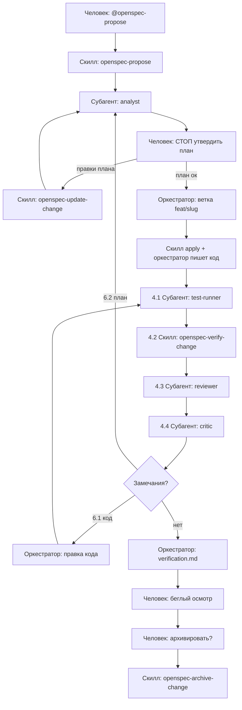

# OpenSpec — документация спецификаций

Индекс документации проекта `cln-arch-sym-simple`. Спецификации поведения
системы живут в [`specs/`](specs/), изменения — в [`changes/`](changes/),
правила генерации артефактов — в [`config.yaml`](config.yaml).

Этот файл — навигация и справочные карты, а не спека: он не описывает
поведение API и не содержит требований.

## Карта доменов

| Домен | Что внутри | Подразделы (use-case'ы) |
|--------|------------|--------------------------|
| [auth](specs/auth/spec.md) | регистрация, логин, refresh, logout | [register](specs/auth/register/spec.md), [login](specs/auth/login/spec.md), [refresh](specs/auth/refresh/spec.md), [logout](specs/auth/logout/spec.md), [cleanup](specs/auth/cleanup/spec.md) |
| [users](specs/users/spec.md) | профиль, поиск, аватар | [list](specs/users/list/spec.md), [get](specs/users/get/spec.md), [query](specs/users/query/spec.md), [query-meta](specs/users/query-meta/spec.md), [update](specs/users/update/spec.md), [delete](specs/users/delete/spec.md) |
| [tasks](specs/tasks/spec.md) | задачи, подзадачи, статусы, участники | [create](specs/tasks/create/spec.md), [status](specs/tasks/status/spec.md), [access](specs/tasks/access/spec.md), [list](specs/tasks/list/spec.md), [delete](specs/tasks/delete/spec.md), [recalculation](specs/tasks/recalculation/spec.md) |
| [task-groups](specs/task-groups/spec.md) | группы задач, пересчёт статусов | [create](specs/task-groups/create/spec.md), [status](specs/task-groups/status/spec.md), [bind](specs/task-groups/bind/spec.md), [access](specs/task-groups/access/spec.md), [summary](specs/task-groups/summary/spec.md), [delete](specs/task-groups/delete/spec.md), [recalculate](specs/task-groups/recalculate/spec.md) |
| [assets](specs/assets/spec.md) | ассеты, изображения, привязка к задачам | [create](specs/assets/create/spec.md), [images](specs/assets/images/spec.md), [progress](specs/assets/progress/spec.md), [view](specs/assets/view/spec.md), [binding](specs/assets/binding/spec.md), [update](specs/assets/update/spec.md) |
| [files](specs/files/spec.md) | загрузка, скачивание, временные файлы | [upload](specs/files/upload/spec.md), [promote](specs/files/promote/spec.md), [metadata](specs/files/metadata/spec.md), [download](specs/files/download/spec.md), [cleanup](specs/files/cleanup/spec.md) |
| [notifications](specs/notifications/spec.md) | настройки и отправка | [preferences](specs/notifications/preferences/spec.md), [delivery](specs/notifications/delivery/spec.md) |

Сквозные (single-file, без подразделов):

| Capability | Что внутри |
|------------|------------|
| [wire](specs/wire/spec.md) | формат идентификаторов (UUID v7) и дат (ATOM) в контракте |
| [errors](specs/errors/spec.md) | конверт `{error, codeId}`, fallback-маппинг, невалидный JSON и UUID в path |
| [query](specs/query/spec.md) | пагинация, сортировка, фильтры, конверт `{items, total, page, perPage}` |
| [async](specs/async/spec.md) | RabbitMQ, retry и `failed`, планировщик |

## Схема данных (обзор)

`users` ──< `assets` / `files` / `task_groups` / `user_notification_preferences` /
`refresh_tokens` (явное удаление при удалении пользователя);
`users` >──< `tasks` (`task_users`, unique `task_id`+`user_id`);
`users` >── `files` (avatar, `ON DELETE SET NULL`);
`tasks` ──< `tasks` (parent, `SET NULL`);
`tasks` >──< `assets` (`asset_task`, CASCADE) и >──< `task_groups` (`task_group_task`, CASCADE);
`assets` >──< `files` (`asset_file`, position).

Таблицы: `users`, `files`, `assets`, `asset_file`, `asset_task`, `tasks`,
`task_users`, `task_groups`, `task_group_task`, `user_notification_preferences`,
`refresh_tokens`. FK-политики: `asset_task`, `task_group_task` — CASCADE;
`tasks.parent_id`, `users.avatar_file_id` — SET NULL; остальные — default/RESTRICT.
Полные колонки — миграция `api/migrations/Version20260930100000.php`.
Docker `php` при `AUTO_MIGRATE=1` выполняет миграции при старте; worker — `AUTO_MIGRATE=0`.

## Окружение

- docker-compose: nginx 8080→80, php (build), postgres :5432, redis :6380,
  rabbitmq :5673/:15673; `messenger-worker` — профиль `workers`.
- Env: `APP_SECRET`, `JWT_SECRET`, `DATABASE_URL`, `REDIS_URL`,
  `MESSENGER_TRANSPORT_DSN`, `MESSENGER_FAILURE_TRANSPORT_DSN`, `MAILER_FROM`,
  `SCHEDULER_*_CRON`.
- Кэш: Redis (`REDIS_URL`) в prod, array-кэш в тестах. Lock пересчёта групп —
  `symfony/lock` поверх Redis, `in-memory` в тестах; ключи — в
  [task-groups](specs/task-groups/spec.md) → Notes.

## Глоссарий

- **Task** — задача, может иметь `parentId` (подзадача).
- **Task user** — участник `task_users` со своим статусом.
- **Task group** — статус вычисляется по составу группы.
- **Asset** — объект с ценой и типом, связан с задачами и файлами.
- **File** — `Temporary` / `Permanent`.
- **Preference** — настройка уведомлений по типу.
- **Transactional type** — обязательное уведомление.
- **Recalculation lock** — `symfony/lock`-лок от параллельного пересчёта одного scope.

## Асинхронность (обзор)

- `TaskCreatedEvent` — только лог.
- `TaskGroupRecalculationByTaskRequestedEvent` — пересчёт групп задачи.
- `TaskGroupRecalculationByGroupIdsRequestedEvent` — пересчёт указанных групп.
- `UserRegisteredEvent` — email.
- `UserUpdatedEvent` — email/SMS по настройке.

Детали реализации поведения — в `## Notes` соответствующих спек;
непокрытые тестами ветви — в секции `## Покрытие тестами`.

## Источник истины и архитектура

- Спеки в `openspec/specs/` описывают **фактическое поведение** кода (`api/src`)
  и тестов (`api/tests`) — это источник истины о текущем поведении системы.
- `api/AGENTS.md` (+ `api/src/Application/AGENTS.md`,
  `api/src/Infrastructure/AGENTS.md`, `api/tests/AGENTS.md`) описывают
  **текущие архитектурные соглашения**: слои, именование, вход/выход use case'ов.
  Они используются при проектировании изменений, а не как описание поведения.
- Changes в `openspec/changes/` описывают будущие изменения (дельты
  ADDED/MODIFIED/REMOVED) по процессу OpenSpec: proposal → specs → design → tasks.
- Расхождения фактического поведения с задокументированным контрактом
  фиксируются в `## Notes` спек и при необходимости становятся отдельными changes.
- Этот README — индекс и справочные карты (домены, схема, глоссарий);
  он не является capability-спекой и не участвует в процессе дельт.

## Поток работы над change

Канон потока — **этот раздел**. Корневой [`README.md`](../README.md) («Поток») —
DoD и установка OpenSpec. Пошаговые скиллы проекта:

| Шаг | Скилл |
|-----|--------|
| 2 custom-analyse | [`custom-analyse`](../.agents/skills/custom-analyse/SKILL.md) |
| 5–8 custom-verify и завершение | [`custom-verify`](../.agents/skills/custom-verify/SKILL.md) |

Остальные шаги — `openspec-*` (propose, apply, update-change, archive) и
оркестратор в основной сессии (ветка, код).

### Легенда на диаграмме

| Подпись | Кто |
|---------|-----|
| Человек | Запуск propose, СТОП на плане, беглый осмотр, archive, коммиты |
| Оркестратор | Основная сессия: код, ветка, вызов скиллов и субагентов |
| Субагент | Роли из `.agents/roles/` (отдельный прохождение / изолированная сессия) |
| Скилл | `openspec-propose`, `openspec-apply-change`, `openspec-verify-change`, `openspec-update-change`, `openspec-archive-change` |

Субагент **не** пишет прод-код (кроме `CriticProbe*` у critic). Скилл
**verify** сверяет реализацию с артефактами change; субагент **reviewer** —
конвенции `AGENTS.md`, не дублирует verify.

### Диаграмма

### Нумерация шагов

1. **propose** — человек; скилл создаёт `proposal`, дельты `specs/`, `design`, `tasks`.
2. **custom-analyse** — `@custom-analyse`: субагент analyst → СТОП →
   `openspec-update-change` (возврат **6.2** идёт **сюда же**).
3. **ветка** `feat/<slug>` — оркестратор после согласия.
4. **apply** — `openspec-apply-change`, код пишет оркестратор.
5. **custom-verify** — `@custom-verify`: 4.1 test-runner → 4.2 verify → 4.3 reviewer → 4.4 critic (≤ 2 раунда).
6. **корректировки** — 6.1: правка кода → снова 4.1; 6.2: снова шаг 2 → 3 → 4 → 5.
   Не больше **трёх** таких итераций, затем СТОП и эскалация.
7. **финальное ревью** — человек; не заменяет зелёный test-runner.
8. **archive** — после заполненного `verification.md` и согласия человека.

**Инвариант:** любая правка кода после прогона → снова **4.1**; прогон до правки
не считается доказательством.

### Субагенты

Канон ролей — `.agents/roles/` (`analyst`, `test-runner`, `reviewer`, `critic`).

1. Субагентом, если инструмент умеет — изоляция важна для `reviewer` и `critic`.
2. Иначе — отдельное прохождение по канону; в `verification.md` — `inline`.
3. `analyst`, `reviewer`, `test-runner` — только чтение; `critic` — только новые
   `CriticProbe*`. Права — в адаптере (OpenCode: `.opencode/agents/`).
